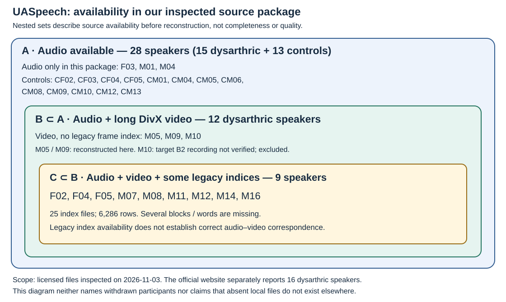
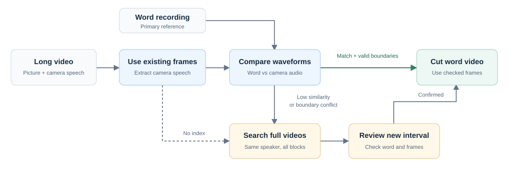
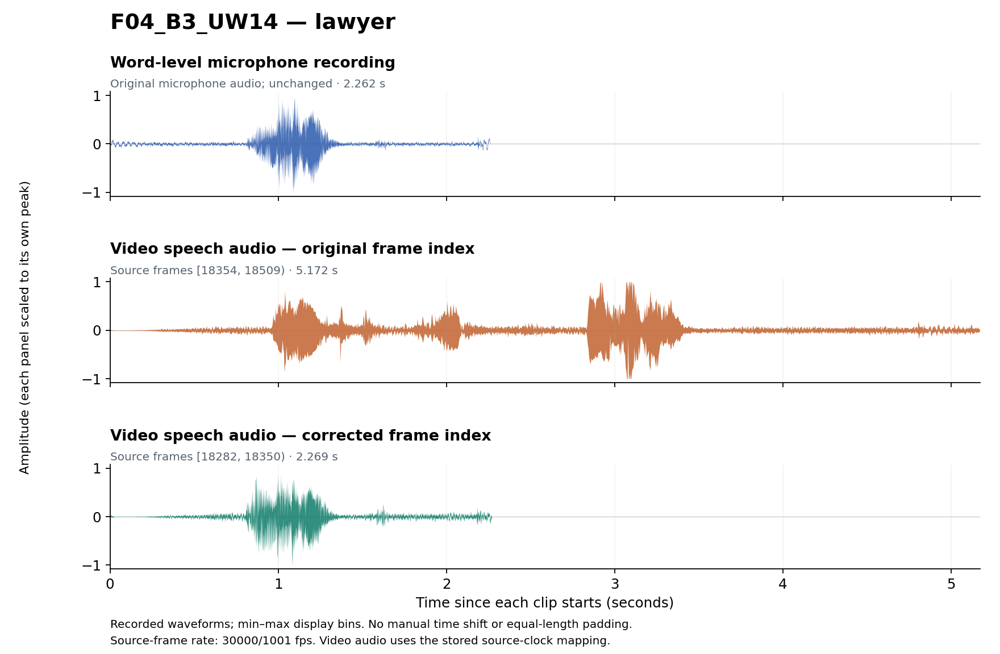

# UASpeech alignment repair

Corrected frame indices and code to reconstruct word-level audio and full-frame
video clips from your licensed UASpeech files. **11 speakers · 8,415 indexed
utterances.** No corpus audio or video is distributed.

[Quick start](#quick-start) · [Cleaning workflow](#cleaning-workflow) ·
[Worked example](#worked-example) · [Detailed guide](docs/DETAILED_GUIDE.md)

## Data coverage

[UASpeech](https://speechtechnology.web.illinois.edu/uaspeech/) is an English
isolated-word corpus for dysarthric speech research. The original UASpeech files
we examined contain audio for 15 dysarthric speakers and 13 controls; 12 dysarthric
speakers have video files, and nine have at least some original frame indices.
The availability described below is based on these source files. B1–B3 are recording
blocks of 255 utterances each (765 per complete speaker).



*Before reconstruction. Counts refer to the whole nested set. M10 has partial
video data, but its B2 recording is missing from these source files.*

### Speaker coverage, major issues and repairs

The table describes missing source video/indices and pairing problems **before
repair**, grouped from greater to lesser speech impairment. “Yes” means complete
video/index coverage, not correct alignment. Affected rates use the audited
existing nine-speaker records; missing indices and later supplemental samples
are counted separately. “—” means no comparable audited denominator.

| Intelligibility | Speaker | Audio | Complete video + index | Main issue | Affected / audited | Action |
|---|---|---|---|---|---|---|
| **Very low** | M04 | Yes | No: no video/index | No source video | — | Exclude from AV set |
| | F03 | Yes | No: no video/index | No source video | — | Exclude from AV set |
| | M12 | Yes | No: partial index | Missing B3 + 3 B2 indices; 1 isolated issue | 1/499 (0.20%) | Recover indices; repair |
| | M01 | Yes | No: no video/index | No source video | — | Exclude from AV set |
| **Low** | M07 | Yes | Yes | Wrong block: mainly B1 audio → B3 video, B2 → B1, B3 → B2 | 765/765 (100%) | Reassign video sources |
| | F02 | Yes | No: partial index | B2 video assignments shifted one word later; missing B3 + 1 B2 index | 256/509 (50.29%) | Recover indices; realign |
| | M16 | Yes | Yes | 6 isolated issues | 6/763 (0.79%) | Review and repair |
| **Medium** | M05 | Yes | No: no index | All three blocks unindexed | — | Reconstruct indices |
| | F04 | Yes | No: partial index | B3 video assignments shifted one word later; 1 missing B3 index | 182/764 (23.82%) | Recover index; realign |
| | M11 | Yes | No: partial index | 84 missing B3 indices; supplemental interval errors | 1/655 (0.15%) | Recover indices; repair |
| **High** | M09 | Yes | No: no index | All three blocks unindexed | — | Reconstruct indices |
| | M14 | Yes | Yes | 13 isolated issues | 13/765 (1.70%) | Review and repair |
| | M08 | Yes | Yes | 3 isolated issues | 3/765 (0.39%) | Review and repair |
| | M10 | Yes | No: incomplete video; no index | Missing B2 recording; B2-labeled file duplicates B3 | — | Exclude from AV set |
| | F05 | Yes | Yes | 19 isolated issues | 19/761 (2.50%) | Review and repair |

The audit found **1,246 / 6,246 affected records (19.95%)**. Separately, we recovered
**2,129 missing original indices**, including M05 and M09.
[Counts and scope](docs/FINDINGS.md) · [Source inventory](docs/CORPUS.md)

## Cleaning workflow

Word-level videos used by a model are cut from long recordings. Each long video
has an embedded camera speech track, which provides the audio reference for its
picture timeline; extraction uses the recorded audio/video clock mapping.
The word-level microphone recording is the primary reference unless inspection
finds that it contains extraneous material or the wrong utterance.



First, use the existing frame index to extract camera speech and compare it with
the word recording using waveform similarity. Retain the interval when the match
and boundaries are consistent. If similarity is low, boundaries conflict, or the
index is missing, search the speaker's full recordings for better matches. Check
the word, neighboring intervals and video frames before cutting at the corrected
position. Confirmed audio problems are reviewed separately: trim non-target
material or use the corresponding camera speech when necessary.
[Matching method](docs/MATCHING.md)

## Quick start

Use Python 3.10+ and install FFmpeg/ffprobe separately. No GPU is needed.
Obtain the source files through the [official access process](https://speechtechnology.web.illinois.edu/uaspeech/).

```bash
git clone https://github.com/wmdljx/UASpeech-data-cleaning.git
cd UASpeech-data-cleaning
python -m pip install -e .
ffmpeg -version
ffprobe -version
python -m uaspeech_cut validate

python -m uaspeech_cut audio --raw-root /path/to/uaspeech_ORIGIN --output ./outputs --id F02_B2_D0
python -m uaspeech_cut video --raw-root /path/to/uaspeech_ORIGIN --output ./outputs --id F02_B2_D0
```

The raw root contains the original distribution directories, including
`UASpeech_original_FM`, `UASpeech_video_0` and `UASpeech_video_1`.
Keep outputs outside that source tree.

The two commands produce paired word audio in `outputs/audio/F02/`, a full-frame
clip in `outputs/video/`, its embedded speech in `outputs/camera_audio/`, and a
video-build receipt in `outputs/receipts/`. Use `--speaker F02` instead of
`--id` for a speaker, or omit both to process all records. Run both commands.
Video outputs are not overwritten; use a fresh output folder for another build.
Full-dataset cutting takes time because source frames are decoded sequentially.

| File | Use |
|---|---|
| [frame_index.tsv](metadata/frame_index.tsv) | Source video and approved frame interval |
| [manifest.csv](metadata/manifest.csv) | Expected output paths |
| [audio_actions.tsv](metadata/audio_actions.tsv) | Instructions to reproduce unchanged, trimmed or replacement audio |
| [source_files.tsv](metadata/source_files.tsv) | Source identity, speech channel and clock mapping |

Source frames use `[begin,end)` at approximately 29.97 fps. These are full-frame
cuts, **not** the earlier 25-fps mouth crops.
[Input layout, audio recipes and conventions](docs/RECONSTRUCTION.md)

## Worked example

**F04_B3_UW14 — “lawyer”.** The original listed video bounds were `[18354,18509)`;
the corrected bounds are `[18282,18350)`. The old interval falls at the neighboring
“Missouri” recording: its 5.17-second speech pattern differs from the 2.26-second
word audio. The corrected camera segment is 2.27 seconds. The word recording is unchanged.



Each row starts at its own clip boundary and is scaled to its own peak; no extra
time shift or stretching is fitted to improve similarity. Recording noise remains
visible. The lower two rows are the speech channel of the same source video.

Generate a three-track comparison from your licensed files:

```bash
python -m pip install matplotlib
python examples/plot_alignment_case.py --raw-root /path/to/uaspeech_ORIGIN --output ./local/F04_B3_UW14-waveforms.png
```

The English labels distinguish **Word-level microphone recording**, **Video speech
audio — original frame index**, and **Video speech audio — corrected frame index**.
The custom review tool supports listening and frame-level checks; its interface
screenshot and source are not part of this quick guide.
[Case evidence and plotting conventions](docs/ALIGNMENT_EXAMPLE.md)

## Further reading

[Detailed guide (preserved)](docs/DETAILED_GUIDE.md) ·
[Verification](docs/VERIFICATION.md) · [Sources](docs/SOURCES.md) ·
[Interactive viewer proposal—not implemented](docs/WEB_DEMO_PLAN.md)

Run `python -m unittest discover -s tests -v` for tests. The repository remains a
private draft pending code-license and publication approval; see [rights](LICENSE.md).
Cite Kim et al., *Dysarthric Speech Database for Universal Access Research*,
Interspeech 2008. This is an independent reconstruction.
