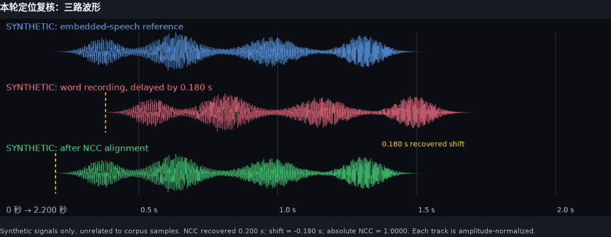
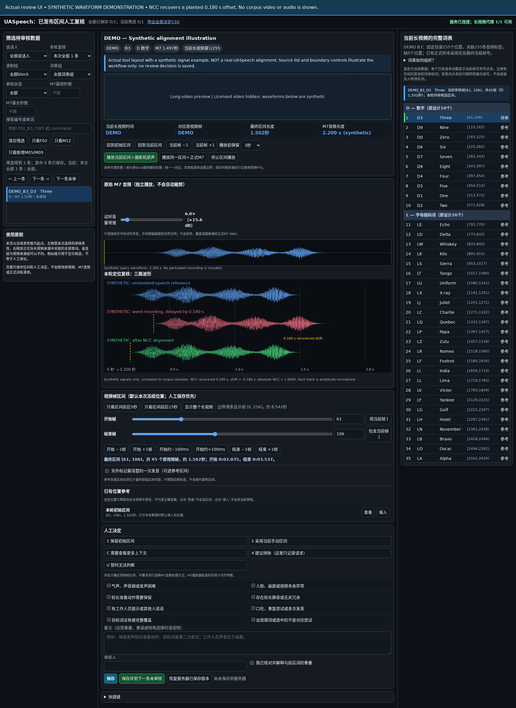

# UASpeech: alignment correction and word-video reconstruction

Corrected video frame indices, paired-audio recipes and reproducible **full-frame
word-video cutting** for a licensed UASpeech package. No audio/video is distributed.
This version deliberately excludes mouth-ROI processing and the review-tool source.

## 1. What is in UASpeech?

[UASpeech](https://speechtechnology.web.illinois.edu/uaspeech/) is an English
isolated-word corpus for dysarthric speech research. The official website currently
reports **16 dysarthric speakers**, whereas the original 2008 publication described
19. The package inspected for this project contains audio for **15 dysarthric and
13 control speakers**. These are different scopes; we do not infer a current
official speaker list from our local files. [Sources: E1–E3](docs/SOURCES.md)

The full word protocol has three blocks, B1–B3, each with 255 utterances: 155 common
items repeated across blocks and 100 block-specific uncommon words. Thus there are
765 utterances, not 765 distinct word types. We retain the existing split:
B1/B3 for training and validation, B2 for testing.

The source package includes word-level microphone WAVs, long DivX videos for a
subset of speakers, word lists, and partial legacy word-to-frame indices. These
three availability sets must not be confused:


*Figure: speaker availability in our inspected package before reconstruction.
Numbers count each complete nested set; IDs appear only in their smallest
applicable region. The outer set contains 15 dysarthric speakers and 13 controls.
“Frame index” means at least some legacy indices, not complete or verified coverage.
M10* has video files but no verified target B2 recording and is excluded from our
reconstruction; M05 and M09 are added after index recovery.*

The nine-speaker inner set has 25 original index files with 6,286 rows, distinct
from the 6,246 historical experimental records audited below. The supplied
indices were automatically extracted from DTMF and not manually verified.
See [corpus details](docs/CORPUS.md) for the scope and complete speaker lists,
or [speaker_availability.csv](metadata/speaker_availability.csv) for the inventory.

### Speaker coverage, major issues and repairs

This table covers **all 15 non-control speakers in the inspected package**.
Intelligibility groups follow the supplied speaker metadata ([E9](docs/SOURCES.md));
lower intelligibility indicates greater speech impairment. Availability describes
the three blocks **before repair**. “Yes” means complete coverage, not correct alignment.

| Speaker | Intelligibility group | Audio | Complete video + index | Main issues | Our treatment |
|---|---|---|---|---|---|
| F02 | Low | Yes | No: incomplete index | Missing B3 indices + one B2 index; sequential shift in B2 | Recover indices; realign video. |
| F03 | Very Low | Yes | No: no video or index | No local source video | Exclude from AV reconstruction. |
| F04 | Medium | Yes | No: incomplete index | One missing B3 index; sequential shift in B3 | Recover index; realign video. |
| F05 | High | Yes | Yes | Isolated issues in 19 samples | Review and repair individually. |
| M01 | Very Low | Yes | No: no video or index | No local source video | Exclude from AV reconstruction. |
| M04 | Very Low | Yes | No: no video or index | No local source video | Exclude from AV reconstruction. |
| M05 | Medium | Yes | No: no index | Missing indices for all three blocks | Reconstruct indices; include speaker. |
| M07 | Low | Yes | Yes | Cross-block audio–video mismatches | Reassign video sources. |
| M08 | High | Yes | Yes | Isolated issues in 3 samples | Review and repair individually. |
| M09 | High | Yes | No: no index | Missing indices for all three blocks | Reconstruct indices; include speaker. |
| M10 | High | Yes | No: incomplete video; no index | Actual B2 video unverified; B2-labeled file duplicates B3 | Exclude from AV reconstruction. |
| M11 | Medium | Yes | No: incomplete index | 84 missing B3 indices; supplemental overlaps/order errors | Recover indices; correct intervals. |
| M12 | Very Low | Yes | No: incomplete index | Missing B3 indices + three B2 indices; 1 sample with an isolated issue | Recover indices; repair the affected sample. |
| M14 | High | Yes | Yes | Isolated issues in 13 samples | Review and repair individually. |
| M16 | Low | Yes | Yes | Isolated issues in 6 samples | Review and repair individually. |

Isolated-issue counts refer to the historical nine-speaker audit, not outstanding
errors or a new census of the expanded dataset. All absence statements are local to the inspected package, not claims about every
corpus copy. Detailed counts and repair procedures are given below and in the
linked inventories.
[Original index counts](docs/CORPUS.md#words-and-supplied-indices) ·
[Historical error counts](docs/FINDINGS.md)

### Which audio is speech, and which is the beep?

The recording setup used an eight-microphone array and an eight-channel audio
interface. One interface channel was reserved for synchronization tones. The
bundled documentation describes **M1 as the usual DTMF synchronization channel**
and **M2–M8 as the usual seven speech files**. Our selected word recording is M7;
it is not a seventh track inside the video. The word WAVs and the video's embedded
audio are separately stored signal paths from the recording session. [E2–E3](docs/SOURCES.md)

The 2008 paper states that speech from the eighth microphone and DTMF tones were
fed into the video camera. Therefore, “camera audio” here means **the speech
reference embedded in the original DivX**, not necessarily the camera's built-in
microphone. DTMF beeps are synchronization markers, not target words. The inspected
DivX files have stereo 44.1-kHz audio and 30000/1001-fps video. Use the explicitly
recorded zero-based speech channel in [source_files.tsv](metadata/source_files.tsv),
not an assumed channel order for arbitrary files. [Channel details](docs/CORPUS.md)

## 2. What went wrong, and how did we repair it?

**Our synchronization reference is the long source video and its embedded speech
track.** We use that reference to locate a valid word recording on the video
timeline; a high match score alone is not treated as proof of lexical correctness.

| Problem | Repair |
|---|---|
| The word audio is correct, but the assigned video interval or source is wrong | Match the word waveform to the embedded speech, check source/block and neighboring words, correct the frame interval, then cut the source video again. |
| The word audio and long video exist, but the word has no frame index | Recover the interval using the same waveform-guided procedure and add the missing index. |
| A small number of word recordings contain extraneous material or the wrong utterance | Manually inspect long recordings and trim confirmed non-target material. If the correct utterance is present in the video but not reliably available in the word recording, extract it from the embedded speech track. |

F02 and F04 predominantly exhibited one-position shifts between the word sequence
and video intervals, particularly in B2 and B3, respectively. Their total historical
affected counts were 256/509 (50.29%) and 182/764 (23.82%); 431 records belonged
specifically to the sequential-shift category. M07 required source reassignment for
all 765 records, predominantly B1 audio → B3 video, B2 → B1, and B3 → B2.
Item-specific exceptions are retained in the released index.

Missing-index recovery added 256 indices for F02, one for F04, 84 for M11, 258 for
M12, and 765 each for M05 and M09: 2,129 in total. The resulting coverage is 765
records for each of 11 speakers. Missing-index recovery and historical error
correction are different counts and must not be added. Original indices also
differ from historical experimental records: M12 had 507 original indices but
499 historical records. M10 was excluded because the B2-labeled file contains a
truncated B3 duplicate and the actual B2 recording was not verified in the available files.

Other exceptions included prompts/conversation, non-target attempts, incomplete
word coverage and local boundary conflicts. These were addressed through the
recorded manual review and source checks; genuine dysarthric speech characteristics
were not automatically classified as errors. [Details and per-speaker counts](docs/FINDINGS.md)

| Scope | Result |
|---|---:|
| Historical nine-speaker records confirmed affected | 1,246 / 6,246 (19.95%) |
| Previously missing word indices reconstructed | 2,129 |
| Added speakers with full block indices | M05 and M09: 765 each |
| Approved word intervals in this cutting package | 8,415 across 11 speakers |

**Cutting scope versus previous experiments.** This package provides cutting
instructions for all 8,415 approved source-video intervals. The previous mouth-ROI experimental release had
8,414 usable pairs (6,245 previously; +34.73%), excluding `M16_B3_CW24` for mouth
localization failure. That is not a reason to discard its full-frame video here.
The historical ROI flag is retained separately; this repository does not reproduce
the ROI experiment inputs or claim all raw cuts have equal audio/video durations.

## 3. Reconstruct the cuts and paired audio

Obtain the source data through the official access process first. Python 3.10+,
NumPy, SciPy, and system FFmpeg/ffprobe are required; no GPU or face detector is needed.

```bash
python -m pip install -e .
python -m uaspeech_cut validate

# Use an output directory separate from your licensed source files.
python -m uaspeech_cut audio --raw-root /path/to/uaspeech_ORIGIN --output ./outputs --id F02_B2_D3
python -m uaspeech_cut video --raw-root /path/to/uaspeech_ORIGIN --output ./outputs --id F02_B2_D3
```

Use `--speaker F02` instead of `--id` for a speaker; see `--help` for the complete
interface. The frozen indices, not a newly rerun match, define the released cuts.

| Delivered metadata | Purpose |
|---|---|
| [frame_index.tsv](metadata/frame_index.tsv) | Exact source key and zero-based half-open frame interval for every word |
| [manifest.csv](metadata/manifest.csv) | Expected full-frame video, paired word audio and separate embedded-speech audio paths |
| [audio_actions.tsv](metadata/audio_actions.tsv) | Executable audio source/crop/clock recipe and expected output PCM hash |
| [source_files.tsv](metadata/source_files.tsv) | Source identities, speech channels, frame rates and clock mapping |
| [release.json](metadata/release.json) | Version and metadata checksums |

The frame index is frozen to `master_v3_media_published_20260912`, also used by the
October 2026 standard eleven-speaker AV experiments. The manifest here describes
**new full-frame outputs**, not the earlier 25-fps mouth crops. Do not apply source
frame numbers to a resampled proxy. [Exact conventions and audio replay](docs/RECONSTRUCTION.md)

## 4. Waveform matching and manual verification

We compare the word waveform with candidate windows in the source video's speech
track using normalized cross-correlation. Matching uses mean removal, resampling
and energy normalization; neighboring word locations constrain the search.
Repeated words, low similarity and conflicting intervals require manual review.
Scores are candidate-ranking values, not calibrated correctness probabilities.
[Short explanation and runnable example](docs/MATCHING.md)



Blue is the reference, red is a copy delayed by 0.180 s, and green is positioned
using NCC. These synthetic signals illustrate the operation, not a measured
delay or similarity score from the corpus.

We developed a dataset-specific frame-level review tool to inspect the long video,
word audio, embedded speech, waveform correspondence and editable intervals.
**Its source and review databases are not included in this release.**



The screenshot illustrates the actual interface with explicitly labeled synthetic
waveforms; licensed video is hidden. It is not evidence of a corpus sample's
alignment quality. Historical records do
not establish that every item received independent manual review.

## Verification, attribution and access

Run `python -m unittest discover -s tests -v` for local tests. See
[verification](docs/VERIFICATION.md), [evidence sources](docs/SOURCES.md) and
[rights](LICENSE.md). The corpus is not freely redistributable. The code-license
and authorship review remains pending before any public release; the current
repository is a private draft. No API keys, original media, patient images or
review databases are included.

Please cite Kim et al., *Dysarthric Speech Database for Universal Access Research*,
Interspeech 2008, pp. 1741–1744. This repository is an independent reconstruction
and is not endorsed by the corpus creators.
