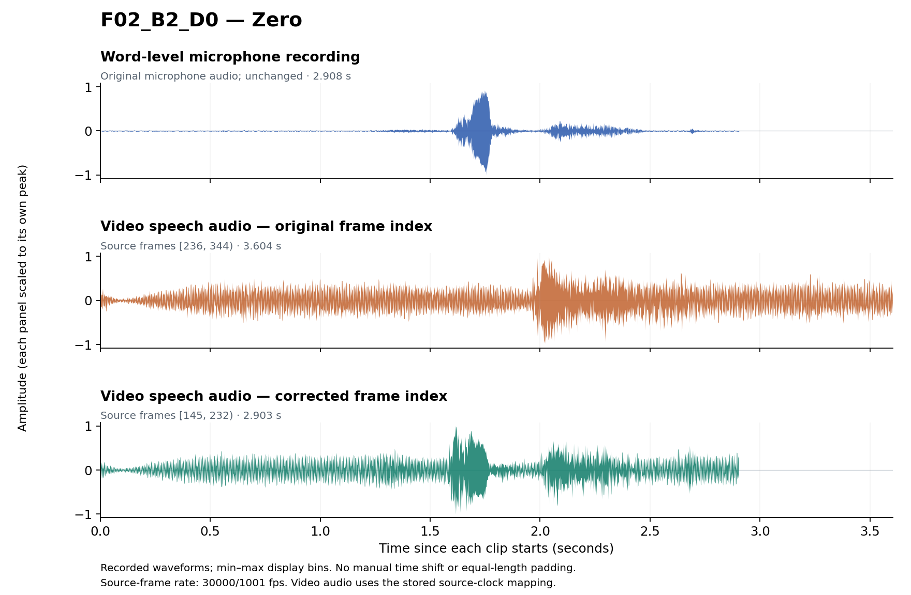

# UASpeech alignment repair

Corrected frame indices and code to reconstruct word-level audio and full-frame
video clips from your licensed UASpeech files. **11 speakers · 8,415 indexed
utterances.** No corpus audio or video is distributed; mouth-region cropping is
outside this repository.

[Quick start](#quick-start) · [Cleaning workflow](#cleaning-workflow) ·
[Worked example](#worked-example) · [Detailed guide](docs/DETAILED_GUIDE.md)

## Data coverage

[UASpeech](https://speechtechnology.web.illinois.edu/uaspeech/) is an English
isolated-word corpus for dysarthric speech research. Our inspected package has
audio for 15 dysarthric speakers and 13 controls; 12 dysarthric speakers have video
files, and nine have at least some original frame indices. These are local
availability counts, not the official corpus population. B1–B3 are recording
blocks of 255 utterances each (765 per complete speaker); B1/B3 supply training
and validation data, and B2 supplies test data.


*Before reconstruction. Counts refer to the whole nested set; IDs appear in their
smallest region. M10 has video files but no verified target B2 recording.*

### Speaker coverage, major issues and repairs

Speakers are grouped from **greater to lesser speech impairment**, using the
supplied intelligibility categories. “Yes” means complete video and index
coverage **before repair**, not correct alignment.

| Intelligibility | Speaker | Audio | Complete video + index | Main issue | Action |
|---|---|---|---|---|---|
| **Very low** | M04 | Yes | No: no video/index | No local video | Exclude from AV set |
| | F03 | Yes | No: no video/index | No local video | Exclude from AV set |
| | M12 | Yes | No: partial index | Missing B3 + 3 B2 indices; 1 isolated issue | Recover indices; repair |
| | M01 | Yes | No: no video/index | No local video | Exclude from AV set |
| **Low** | M07 | Yes | Yes | Cross-block mismatch | Reassign video sources |
| | F02 | Yes | No: partial index | Missing B3 + 1 B2 index; B2 sequence shift | Recover indices; realign |
| | M16 | Yes | Yes | 6 isolated issues | Review and repair |
| **Medium** | M05 | Yes | No: no index | All three blocks unindexed | Reconstruct indices |
| | F04 | Yes | No: partial index | 1 missing B3 index; B3 sequence shift | Recover index; realign |
| | M11 | Yes | No: partial index | 84 missing B3 indices; supplemental interval errors | Recover indices; repair |
| **High** | M09 | Yes | No: no index | All three blocks unindexed | Reconstruct indices |
| | M14 | Yes | Yes | 13 isolated issues | Review and repair |
| | M08 | Yes | Yes | 3 isolated issues | Review and repair |
| | M10 | Yes | No: incomplete video; no index | B2-labeled file duplicates B3 | Exclude from AV set |
| | F05 | Yes | Yes | 19 isolated issues | Review and repair |

Isolated-issue counts come from the historical nine-speaker audit, not unresolved
errors. That audit found **1,246 / 6,246 affected records (19.95%)**. Separately,
we recovered **2,129 missing original indices**, including M05 and M09.
[Counts and scope](docs/FINDINGS.md) · [Source inventory](docs/CORPUS.md)

## Cleaning workflow


We match each word recording against the **speech track embedded in the source
video**, using normalized cross-correlation of audio waveforms. Word order,
neighboring intervals and manual frame-level review resolve uncertain matches.
Valid word audio is retained; confirmed non-target material is trimmed, or the
video speech is used when the word recording cannot supply the target.
The approved indices and audio recipes—not a new match—define the released cuts.
[Matching method](docs/MATCHING.md)

## Quick start

Use Python 3.10+ and install FFmpeg/ffprobe separately. No GPU is needed.
Obtain the source files through the [official access process](https://speechtechnology.web.illinois.edu/uaspeech/).

```bash
git clone https://github.com/wmdljx/UASpeech-data-cleaning.git
cd UASpeech-data-cleaning
python -m pip install -e .
ffmpeg -version
ffprobe -version
python -m uaspeech_cut validate

python -m uaspeech_cut audio --raw-root /path/to/uaspeech_ORIGIN --output ./outputs --id F02_B2_D0
python -m uaspeech_cut video --raw-root /path/to/uaspeech_ORIGIN --output ./outputs --id F02_B2_D0
```

The raw root contains the original distribution directories, including
`UASpeech_original_FM`, `UASpeech_video_0` and `UASpeech_video_1`.
Keep outputs outside that source tree.

The two commands produce paired word audio in `outputs/audio/F02/`, a full-frame
clip in `outputs/video/`, its embedded speech in `outputs/camera_audio/`, and a
video-build receipt in `outputs/receipts/`. Use `--speaker F02` instead of
`--id` for a speaker, or omit both to process all records. Run both commands.
Video outputs are not overwritten; use a fresh output folder for another build.
Full-dataset cutting takes time because source frames are decoded sequentially.

| File | Use |
|---|---|
| [frame_index.tsv](metadata/frame_index.tsv) | Source video and approved frame interval |
| [manifest.csv](metadata/manifest.csv) | Expected output paths |
| [audio_actions.tsv](metadata/audio_actions.tsv) | Instructions to reproduce unchanged, trimmed or replacement audio |
| [source_files.tsv](metadata/source_files.tsv) | Source identity, speech channel and clock mapping |

Source frames use `[begin,end)` at approximately 29.97 fps. These are full-frame
cuts, **not** the earlier 25-fps mouth crops.
[Input layout, audio recipes and conventions](docs/RECONSTRUCTION.md)

## Worked example

**F02_B2_D0 — “Zero”.** The original listed video bounds were `[236,344)`;
the corrected bounds are `[145,232)`. The old interval nearly coincides with the
corrected “Six” interval. The word recording is unchanged.



Each row starts at its own clip boundary and is scaled to its own peak; no extra
time shift or stretching is fitted to improve similarity. Recording noise remains
visible. The lower two rows are the speech channel of the same source video.

Generate a three-track comparison from your licensed files:

```bash
python -m pip install matplotlib
python examples/plot_alignment_case.py --raw-root /path/to/uaspeech_ORIGIN --output ./local/F02_B2_D0-waveforms.png
```

The English labels distinguish **Word-level microphone recording**, **Video speech
audio — original frame index**, and **Video speech audio — corrected frame index**.
The custom review tool supports listening and frame-level checks; its interface
screenshot and source are not part of this quick guide.
[Case evidence and plotting conventions](docs/ALIGNMENT_EXAMPLE.md)

## Further reading

[Detailed guide (preserved)](docs/DETAILED_GUIDE.md) ·
[Verification](docs/VERIFICATION.md) · [Sources](docs/SOURCES.md) ·
[Interactive viewer proposal—not implemented](docs/WEB_DEMO_PLAN.md)

Run `python -m unittest discover -s tests -v` for tests. The repository remains a
private draft pending code-license and publication approval; see [rights](LICENSE.md).
Cite Kim et al., *Dysarthric Speech Database for Universal Access Research*,
Interspeech 2008. This is an independent reconstruction.
