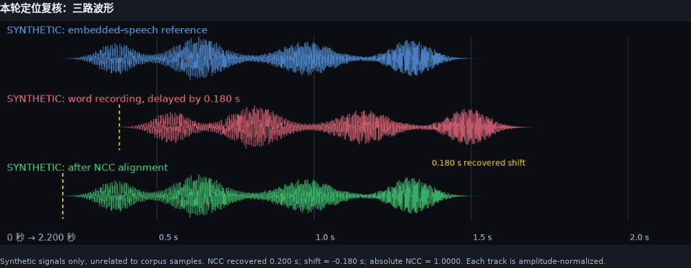

# Waveform-guided candidate search

The reference is the speech track embedded in the original long DivX recording.
The query is a word-level microphone recording that contains the target utterance.
Our task is to find where the same acoustic event occurs in that reference.

1. Decode speech rather than the DTMF channel, and use a common sample rate.
   The historical search implementation used 4 kHz for efficient retrieval.
2. Remove the mean and normalize signal energy. This reduces sensitivity to
   constant offsets and recording gain.
3. Slide the query over a bounded region of the reference and compute normalized
   cross-correlation (NCC). FFT correlation and running window sums avoid
   recomputing each window from scratch.
4. Rank separated peaks by absolute NCC, allowing microphone polarity inversion.
   Keep multiple candidates when repeated utterances or weak matches are present.
5. Convert candidate audio times to the reviewed video clock using the calibrated
   mapping, then inspect the corresponding frames. Use known neighboring words,
   block/source checks and manual review to decide the final boundaries.

For query `q` and a same-length reference window `x_t`, NCC is the dot product of
their mean-centered waveforms divided by the product of their Euclidean norms.
Its magnitude measures waveform similarity, **not the probability that the word,
speaker or recording block is correct**. Silence has no usable correlation.



The review-interface illustration uses synthetic signals with a known 0.180-s
shift, recovered by the same NCC implementation. It contains no UASpeech audio
and is not a corpus-quality result. The small example below independently tests
retrieval with additive noise.

A gain-scaled copy of the same recording can score highly. A different attempt
at the same word may not. Wrong or overly tight neighboring anchors can exclude
the right answer, so an ordering rule alone must not propagate one mistaken
boundary through the rest of a block. Ambiguous cases are checked against other
candidate source videos and the long-video context.

Run the small synthetic example, which distributes no corpus audio:

```bash
python examples/synthetic_match.py
```

For your own licensed mono PCM16/16-kHz recordings, use the same code with
explicit clock coefficients from the source table (the numbers below are only
an example, not coefficients to reuse across files):

```bash
python examples/match_waveforms.py word.wav camera_speech.wav \
  --start 100 --end 150 --clock-slope 1.000 --clock-intercept -0.04
```

`camera_speech.wav` is the decoded full selected channel, not a stereo downmix.
The output lists candidate times and rounded start frames for review; it does
not claim to infer an approved word end from one peak.

The example illustrates retrieval, not the whole historical human decision
process. It does not promise universal thresholds or sub-frame ground truth.
For new recordings, clock calibration and channel validation must precede frame
conversion. The final repository frame index contains the approved intervals;
re-running a search is optional and must not silently replace them.
